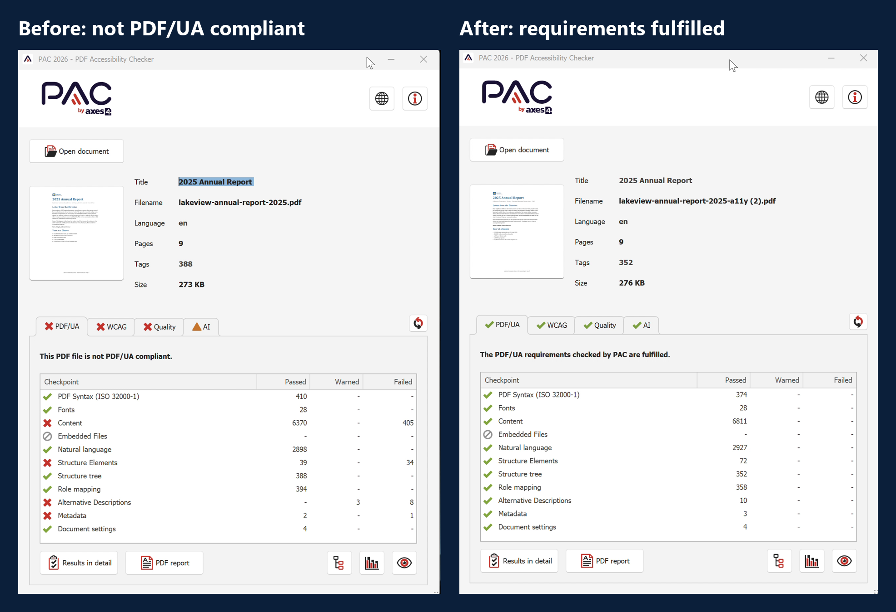
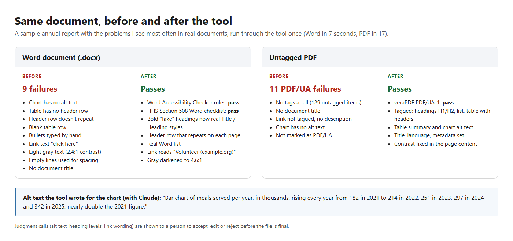
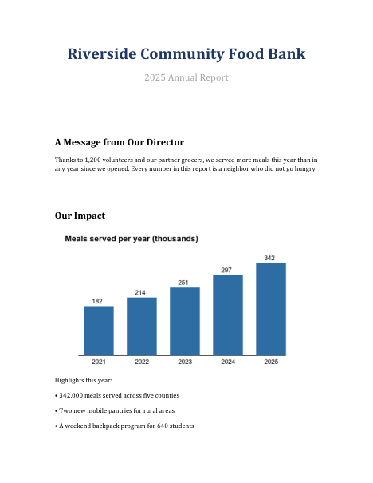

# Document Accessibility Remediator

A tool I built that makes PDFs and Word documents accessible (Section 508, WCAG 2.1 AA, PDF/UA-1).
It fixes the repetitive problems automatically, writes alt text and table descriptions with AI, and
leaves only the judgment calls for a person to review.

*The source code is private. This page shows what the tool does and the results. I'm happy to walk
through the code or give a live demo; message me here on GitHub or on LinkedIn.*

## Demo

https://github.com/user-attachments/assets/ae6c6dd0-5ba3-4505-9481-144f5c6e0f65

**46-second demo:** a 9-page report auto-tagged by Acrobat goes in with 55
failing checks and comes out passing PAC 2026 and the Acrobat Accessibility Checker.

## What it does

**PDFs**
- Tags untagged PDFs (with OCR for scanned pages) and repairs existing tag trees: headings, lists, tables (header cells, scope,
  summaries), links, reading order, artifacts
- Writes figure alt text, document titles and table summaries with the Claude API, and learns from
  the reviewer's past corrections
- Fixes fonts, metadata, language, contrast, bookmarks and tab order
- Validates every file with veraPDF (PDF/UA-1) and keeps fixing until it passes, or reports exactly
  what is left

**Word documents (.docx)**
- Turns bold "fake" headings into real heading styles, typed bullets into real lists, and
  tab-aligned text into tables
- Sets table header rows (repeating on each page), removes blank rows, splits tables that use
  merged rows as section titles
- Writes alt text for pictures and charts, fixes vague link text, low contrast and empty spacing lines,
  moves text boxes into reading order, and sets the title and language
- Checks the result against both **Word's Accessibility Checker** rules and the **HHS Section 508
  Word checklist**, and can run Word's own checker to confirm

**Built for review, not blind automation.** Every judgment call (alt text, heading levels, link
wording, table descriptions) appears in a review screen where a person can accept, edit or reject it
before downloading the final file.

## Results

| Test | Result |
|---|---|
| **35 real public documents** (396 pages: agendas, county reports, IRS forms) | Automated accessibility failures cut by 91% (1,386 -> 123), typically about a minute per document, 0 crashes, no lost content |
| Demo report (9 pages, auto-tagged by Acrobat) | 55 failing checks before; passes PAC 2026 and the Acrobat Accessibility Checker after review |
| Sample report in this repo, Word version | Fails 9 checks before; passes Word's checker rules + HHS 508 after |
| Sample report in this repo, untagged PDF | Fails 11 PDF/UA checks before; passes veraPDF PDF/UA-1 after |
| Unusual Word files (Apache POI test suite: forms, charts, nested tables, old Word formats) | 0 crashes; anything that needs a person is flagged with the reason |
| Synthetic stress test (untagged, scanned, complex tables, forms, broken files) | Failing checks cut by 91% (89 -> 8); broken files refused with a clear reason, 0 crashes |
| Real documents I remediated with it | Pass the Acrobat Accessibility Checker and PAC 2026 |
| Automated tests | 130+ |

Try it yourself: [`samples/`](samples) has the sample report before and after, as a Word file and as a PDF.
Open them in Word (Review > Check Accessibility), Acrobat, or PAC.

## How results are checked

Every file goes through four layers, and the report keeps them apart:

1. **The tool's own checks**: structure that can be decided mechanically (alt text present,
   heading order, table headers, tagged links and form fields, consistent tag tree)
2. **An independent validator**: veraPDF for PDF/UA-1; Microsoft Word's own Accessibility
   Checker for Word files
3. **Content integrity**: the output is compared with the original (every page, word, link and
   picture, and the rendered look); a scanned page with no real text fails
4. **A person**: every AI or heuristic decision is a reviewable proposal, and every report ends
   with a WCAG-referenced checklist of what software can't judge (reading order, alt-text
   accuracy, table meaning, color-only information)

A result is reported as "passes automated checks", never as "compliant". The benchmark
shows why: a table with a two-row header passes every automated check while its headers
are wrong, so the tool flags it for a person instead.

## How it works

1. Upload a PDF or Word file in the web app (or run it from the command line on a whole folder).
2. The tool fixes what it can, asks Claude for alt text and descriptions, and validates the result.
3. A person reviews the judgment calls, clicks **Apply my decisions**, and downloads the file.
4. A report lists what was fixed, what was reviewed, and anything that still needs manual work.

## Built with

Python, pikepdf, pdfplumber, PyMuPDF, fontTools, python-docx / lxml, Flask, the Claude API,
the Adobe PDF Services API, veraPDF, Tesseract OCR, Docker, and Windows UI Automation (to run Word's own
Accessibility Checker).

---

Built by Matias Awdew. The sample and demo reports are fictional.
